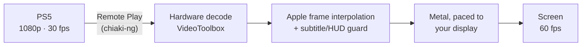

  

<h1 align="center">Framelift</h1>

<h2 align="center">Play your PS5 on your Mac at up to 60 fps</h2>

Native Remote Play for Apple Silicon. Stream over Wi-Fi or Ethernet and play with your DualSense.

  

  
  
  
  

## What you get

- **Smoother motion.** Apple’s on-device frame interpolation can turn a 30 fps SDR stream into 60 fps and keep subtitles and HUD elements sharp.
- **Play on your screen of choice.** Stream at 1080p or 720p, play fullscreen on a monitor or TV, and use HDR on compatible displays.
- **DualSense support.** Touchpad, motion controls, rumble, haptics and adaptive triggers.

## Install

You need an Apple Silicon Mac (M1 or newer), macOS 26 or later, and a game controller. Use macOS 27 for 1080p frame generation.

1. Download `Framelift-<version>-macOS-arm64.zip` from [Releases](../../releases/latest), unzip it and move **Framelift.app** to Applications.
2. Open Framelift. If macOS blocks the first launch, approve it under **System Settings › Privacy & Security › Open Anyway**.

Use **Framelift › Check for Updates…** to check now. Manage automatic checks and installs in **Settings › Updates**.

## First run

1. On the PS5, turn on **Settings › System › Remote Play › Enable Remote Play**.
2. In Framelift, click **Pair** next to your PS5 and **Sign in with PlayStation**, using the account that's signed in on the PS5.
3. On the PS5, open **Remote Play › Pair Device** and type the 8-digit PIN into Framelift.
4. Click your PS5 to start playing. Esc or ⇧⌘Q leaves the stream.

## Network

Connect the Mac and PS5 to the same local network. Wi-Fi, Ethernet, and a mix of the two all work.

For a direct cable from the PS5 to the Mac, use **System Settings › General › Sharing › Internet Sharing** to share the Mac’s connection over Ethernet. A MacBook may need a USB-C Ethernet adapter.

## Settings

See [Settings and debug logs](docs/SETTINGS.md).

## How it works

Tested on a MacBook Air with M4 and a 120 Hz display: a generated frame takes about 13 ms, a frame reaches the screen 26–52 ms after it arrives, and a button press shows up about 90 ms later. Generated frames make motion smoother but don't reduce input lag: the game still runs at 30 fps.

## Limits

- Local network only.
- HDR uses the source frame rate. Frame interpolation requires SDR.
- Output is up to 60 fps.

## More

- [Settings, debug logs and reporting bugs](docs/SETTINGS.md)
- [Building from source and contributing](CONTRIBUTING.md)
- [Security policy](SECURITY.md) · [Changelog](CHANGELOG.md)

## Credits

Built on [chiaki-ng](https://github.com/streetpea/chiaki-ng) and the original Chiaki by Florian Märkl, with code ported from [Veyra](https://github.com/Likely7/Veyra-NRVideo), [PushFPS](https://github.com/DosukaSOL/PushFPS) and [P5M](https://github.com/beecrepaldi-afk/P5M). See [THIRD_PARTY_NOTICES.md](THIRD_PARTY_NOTICES.md).

## License

[AGPL-3.0](LICENSE). Individual files keep their own SPDX license headers (GPL-3.0 for code ported from Veyra and PushFPS, AGPL-3.0 with an OpenSSL exception for chiaki-ng).

Not affiliated with, endorsed or sponsored by Sony Interactive Entertainment. PlayStation, PS5 and DualSense are trademarks of Sony Interactive Entertainment Inc.
