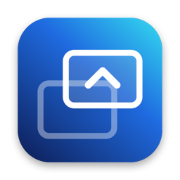
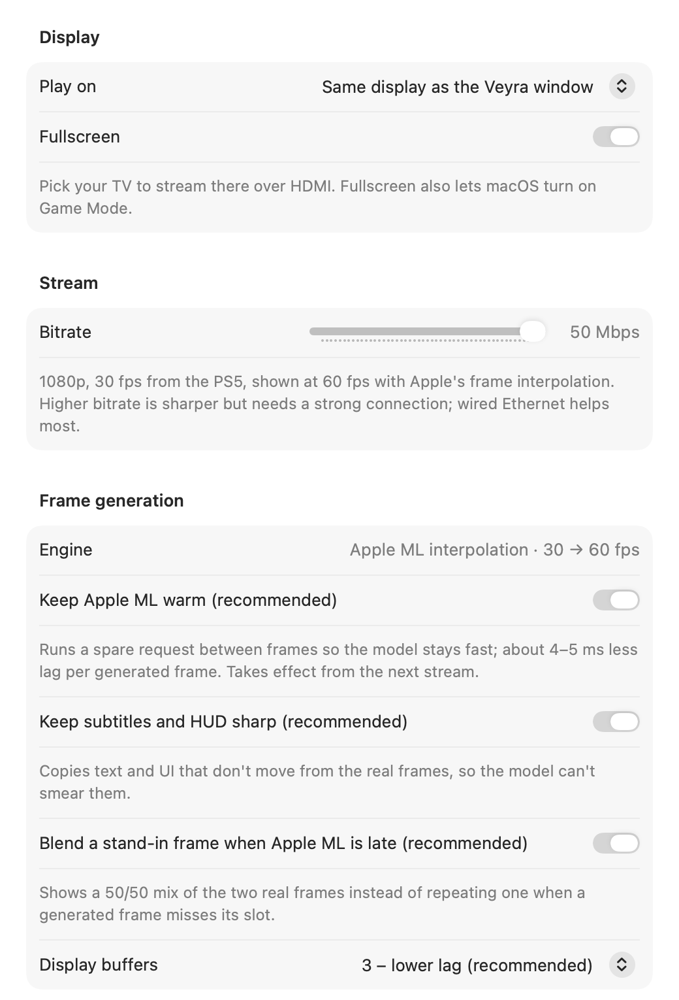
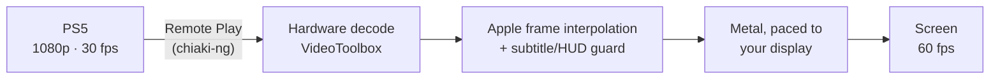

  

<h1 align="center">Framelift</h1>

Play your PS5 on your Mac at a smooth 60 fps.

  

  
  
  

Framelift is a native PS5 Remote Play app for Apple Silicon. Most PS5 games stream at 30 fps; Framelift adds an in-between frame for every pair with Apple's on-device frame interpolation, so motion looks like 60 fps. It runs on your local network, over Wi-Fi or Ethernet.

## Features

- **30 → 60 fps** with Apple's `VTLowLatencyFrameInterpolation`, at full 1080p.
- **Sharp subtitles and HUD.** Text and UI that don't move are copied from the real frames, so the model can't smear them.
- **Low lag.** Connects to the PS5 directly: no capture card, no screen capture of another app.
- **Any screen.** Built-in display, external monitor or a TV over HDMI, paced to its refresh rate.
- **DualSense** buttons, touchpad, motion, rumble, haptics and adaptive triggers.
- **Private.** Pairing and streaming stay on your network; pairing keys stay on your Mac.

## Install

1. Download `Framelift-<version>-macOS-arm64.zip` from [Releases](../../releases/latest), unzip it and move **Framelift.app** to Applications.
2. Open it. The app isn't notarized yet, so macOS blocks the first launch: go to **System Settings › Privacy & Security** and click **Open Anyway**.

## First run

1. On the PS5, turn on **Settings › System › Remote Play › Enable Remote Play**.
2. In Framelift, click **Pair** next to your PS5 and **Sign in with PlayStation**, using the account that's signed in on the PS5.
3. On the PS5, open **Remote Play › Pair Device** and type the 8-digit PIN into Framelift.
4. Click your PS5 to start playing. Esc or ⇧⌘Q leaves the stream.

## Best setup

A wired connection gives the steadiest picture and the lowest lag. From best to good:

1. **Direct cable (best).** Connect the PS5 straight to your Mac with an Ethernet cable (a USB-C Ethernet adapter on a MacBook). On the Mac, open **System Settings › General › Sharing**, click the **ⓘ** next to **Internet Sharing**, share your Wi-Fi connection to the Ethernet adapter, and turn Internet Sharing on. On the PS5, set up a wired connection with automatic settings. The PS5 gets internet through the Mac, and the stream never touches Wi-Fi.
2. **Both on Ethernet.** Plug the PS5 and the Mac into your router.
3. **Wi-Fi.** Works, but expect occasional hiccups. Use 5 GHz or 6 GHz and keep the router close.

The bitrate defaults to 30 Mbps, which suits most Wi-Fi. On a cable, raise it to 50 Mbps in Settings for the sharpest picture.

## Settings

The defaults are the recommended values, so most people never need to change anything. Details are in [docs/SETTINGS.md](docs/SETTINGS.md).

  <picture>
    <source media="(prefers-color-scheme: dark)" srcset="docs/images/settings-dark.png">
    
  </picture>

## How it works

Tested on a MacBook Air with M4 and a 120 Hz display: a generated frame takes about 13 ms, a frame reaches the screen 26–52 ms after it arrives, and a button press shows up about 90 ms later. Generated frames make motion smoother but don't reduce input lag: the game still runs at 30 fps.

## FAQ

<b>Can I play away from home?</b>

Not yet. The Mac and the PS5 must be on the same local network.

<b>Which Macs are supported?</b>

All Apple Silicon Macs (M1 or newer) on macOS 27. It's tested on a MacBook Air with M4.

<b>Why can it stutter on a MacBook Air?</b>

MacBook Air models have no fan. In long sessions they warm up and slow down to cool off, so frame generation can miss frames now and then. A cooler spot or a stand helps, and so does Ethernet instead of Wi-Fi. Macs with a fan don't have this problem.

<b>Does it support HDR or 120 fps?</b>

No. The stream is SDR, and the output target is 60 fps.

## More

- [Settings, debug logs and reporting bugs](docs/SETTINGS.md)
- [Building from source and contributing](CONTRIBUTING.md)
- [Security policy](SECURITY.md) · [Changelog](CHANGELOG.md)

## Credits

Built on [chiaki-ng](https://github.com/streetpea/chiaki-ng) and the original Chiaki by Florian Märkl, with code ported from [Veyra](https://github.com/Likely7/Veyra-NRVideo), [PushFPS](https://github.com/DosukaSOL/PushFPS) and [P5M](https://github.com/beecrepaldi-afk/P5M). See [THIRD_PARTY_NOTICES.md](THIRD_PARTY_NOTICES.md).

Framelift started from the Windows app [Veyra](https://github.com/Likely7/Veyra-NRVideo) by Likely7: its C++20 Remote Play core, trigger filter and shot-change shader are ported from Veyra, and its controller queue from [PushFPS](https://github.com/DosukaSOL/PushFPS). Framelift is an independent project and is not affiliated with or endorsed by Veyra, PushFPS or their authors.

## License

[AGPL-3.0](LICENSE). Individual files keep their own SPDX license headers (GPL-3.0 for code ported from Veyra and PushFPS, AGPL-3.0 with an OpenSSL exception for chiaki-ng).

Not affiliated with, endorsed or sponsored by Sony Interactive Entertainment. PlayStation, PS5 and DualSense are trademarks of Sony Interactive Entertainment Inc.
